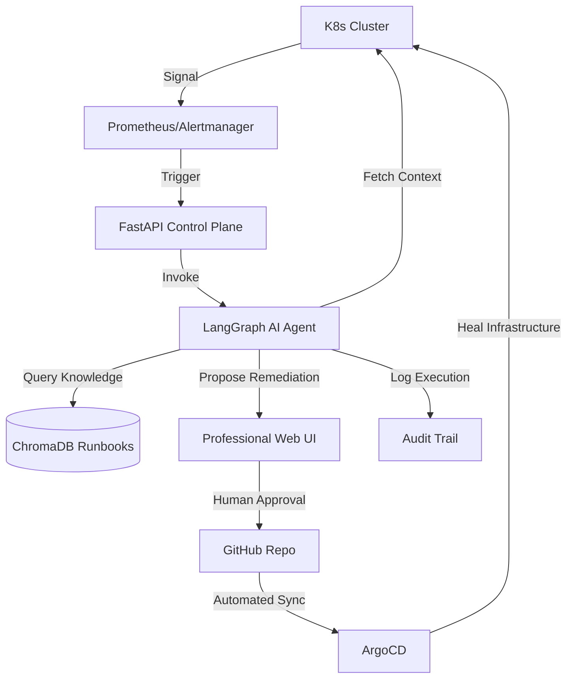

# 🌐 OmniRoute: Enterprise AIOps Self-Healing Control Plane

[](https://kubernetes.io/)
[](https://langchain-ai.github.io/langgraph/)
[](https://argoproj.github.io/cd/)
[](https://fastapi.tiangolo.com/)

## 📖 Executive Summary
**OmniRoute** is a production-grade AIOps platform designed to eliminate the "3 AM wake-up call" for SREs. It transforms traditional reactive monitoring into an **autonomous self-healing loop**. 

Unlike simple scripts, OmniRoute implements a **Control Plane** architecture that combines **LLM-driven reasoning (LangGraph)**, **Knowledge Retrieval (RAG)**, and **Immutable Infrastructure (GitOps)** to diagnose and remediate Kubernetes incidents with human-in-the-loop safety guardrails.

---

## 🛠️ Tech Stack Used:
- **AI Framework:** LangGraph (Stateful Agentic Workflows)
- **LLM:** OpenAI GPT-4o (Reasoning Engine)
- **Vector DB:** ChromaDB (RAG for Runbooks)
- **Backend:** FastAPI (Control Plane API)
- **Frontend:** HTML5/Tailwind CSS (Cyber-Ops Dashboard)
- **Infrastructure:** Kubernetes (Kind/EKS)
- **GitOps:** ArgoCD (Automated Deployment)
- **Security:** K8s RBAC (Least Privilege Access)

---

## 🚀 Enterprise Feature Set (Real-World Solutions)

| Real-World Issue | OmniRoute Solution | Technical Implementation |
| :--- | :--- | :--- |
| **Alert Fatigue** | **Autonomous Diagnosis** | AI Agent automatically aggregates logs and metrics *before* paging a human. |
| **Human Error in Fixes** | **Runbook Grounding (RAG)** | Fixes are retrieved from verified human-written runbooks, not LLM hallucinations. |
| **Production Risk** | **Human-in-the-Loop (HITL)** | A professional UI requires an engineer to "Approve" any fix before it is applied. |
| **Configuration Drift** | **GitOps Remediation** | No `kubectl edit`. All fixes are committed to Git and synced via ArgoCD. |
| **Lack of Accountability** | **Immutable Audit Trail** | Every decision, from diagnosis to approval, is logged in a tamper-proof audit trail. |

---

## 📐 System Architecture

### 🔹 The AIOps Loop


---

## 🎙️ Interviewer's Guide: How to Explain This Project

**1. The "Why" (The Problem):**
> "In most production environments, SREs suffer from alert fatigue. I built OmniRoute to automate the 'Triage' and 'Remediation' phases of the incident lifecycle, reducing MTTR significantly."

**2. The "How" (The Technical Approach):**
> "I implemented a stateful agent using **LangGraph**. It pulls real-time logs, uses **RAG via ChromaDB** to find a matching verified runbook, and classifies the fix as 'Safe' or 'Risky'."

**3. The "Production Mindset" (The Safety):**
> "To ensure safety, I implemented **Human-in-the-Loop approval** via a custom dashboard and a **GitOps workflow using ArgoCD**, ensuring every change is versioned and reversible."

---

## 🛠️ Step-by-Step Setup Guide

### 📋 Pre-requisites:
- **Docker Desktop** installed.
- **Kind** or **Minikube** installed.
- **kubectl** installed.
- **Python 3.10+** installed.
- **OpenAI API Key** configured.

### 1️⃣ Infrastructure Setup
```bash
# Create a local Kubernetes cluster
kind create cluster --name omniroute-cluster

# Apply Security Guardrails (Least Privilege RBAC)
kubectl apply -f infra/rbac/agent-rbac.yaml

# Seed the Chaos Failures (Create the "problems" to fix)
kubectl apply -f infra/chaos/failure-seeds.yaml

# Verify failures
kubectl get pods
```

### 2️⃣ Backend Installation
```bash
# Clone and enter the repository
git clone https://github.com/Ayush-Singh986/GitOps-Driven-Self-Healing-Infrastructure.git
cd GitOps-Driven-Self-Healing-Infrastructure

# Set up virtual environment
python3 -m venv venv
source venv/bin/activate

# Install dependencies
pip install -r requirements.txt

# Set API Key & Start Server
export OPENAI_API_KEY='your-api-key'
uvicorn main:app --host 0.0.0.0 --port 8000
```

### 3️⃣ Dashboard Launch
```bash
# Open the professional Cyber-Ops UI in your browser
open frontend/index.html
```

### 4️⃣ End-to-End Validation (The Demo Loop)
**Step A: Trigger AI Diagnosis**
```bash
curl -X POST "http://localhost:8000/trigger-diagnosis" \
     -H "Content-Type: application/json" \
     -d '{"alert_id": "alert-oom-001"}'
```

**Step B: Review & Approve**
1. Open `frontend/index.html`.
2. Review the **Incident Feed** $\rightarrow$ Click **[Approve Fix]**.

**Step C: Verify Healing**
```bash
kubectl get pods
cat agent_audit.log
```

---

## 🧹 Clean Up
```bash
kind delete cluster --name omniroute-cluster
```
