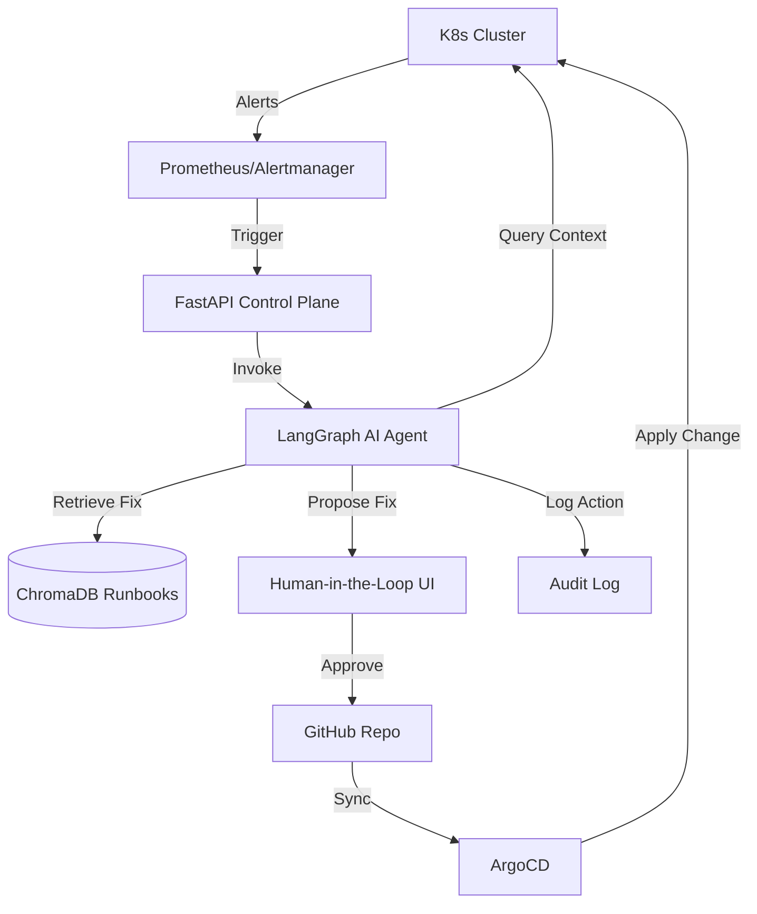
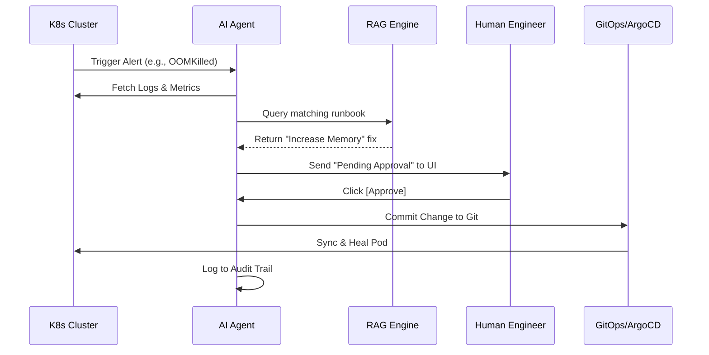

# 🚀 GitOps-Driven Self-Healing Infrastructure

An autonomous AI agent for Kubernetes incident detection & remediation (AIOps).

## 🌟 Project Overview (The "Beginner-Friendly" Explanation)

### What is this project?
Imagine a Kubernetes cluster (the system that runs your apps) as a large city. Sometimes, things break: a building collapses (a Pod crashes), or a road gets blocked (a Disk fills up). Normally, a human engineer (an "On-Call Engineer") gets a phone call at 3 AM, wakes up, logs in, and fixes it.

**This project replaces that 3 AM phone call with an AI Agent.**

### How does it work?
1.  **The Alarm (Prometheus/Alertmanager):** The system detects a problem (e.g., "App X is crashing") and sends an alarm.
2.  **The Brain (LangGraph Agent):** The AI agent hears the alarm. It doesn't just guess; it acts like a detective. It looks at the logs, checks the memory usage, and asks, "Why is this happening?"
3.  **The Library (RAG Runbooks):** The agent looks at a "Runbook"—a manual written by humans that says: *"If the app crashes because of memory, increase the memory limit."*
4.  **The Safety Guard (Decision):** The agent decides if the fix is **Safe** (e.g., "I'll just give it more memory") or **Risky** (e.g., "I need to delete a database"). 
    - If it's **Safe**, it fixes it automatically.
    - If it's **Risky**, it writes a detailed report and asks a human for help.
5.  **The Robot Hand (ArgoCD/GitOps):** Instead of just "hacking" the system, the agent follows a strict process: it makes a change in the code (Git), and **ArgoCD** safely applies that change to the cluster.

---

## 🛠️ Professional Step-by-Step Setup Guide

This guide will take you from a blank machine to a fully functioning AIOps Control Plane.

### 1️⃣ Phase 1: Environment Prerequisites
Ensure you have the following installed on your machine:
- **Docker Desktop** (or Docker Engine)
- **Kind** (`brew install kind`) or **Minikube**
- **kubectl** (`brew install kubernetes-cli`)
- **Python 3.10+**
- **OpenAI API Key** (Get one at [platform.openai.com](https://platform.openai.com))

### 2️⃣ Phase 2: Infrastructure Deployment
We need to create a "broken" cluster for the AI to heal.

```bash
# 1. Create a local Kubernetes cluster
kind create cluster --name self-healing-cluster

# 2. Install the AI Agent's Security Guardrails (RBAC)
# This ensures the AI can only touch what it is allowed to
kubectl apply -f infra/rbac/agent-rbac.yaml

# 3. Seed the "Chaos" failures
# This creates pods that are OOMKilled and in CrashLoopBackOff
kubectl apply -f infra/chaos/failure-seeds.yaml

# 4. Verify the failures exist
kubectl get pods
# You should see pods with status 'CrashLoopBackOff' or 'OOMKilled'
```

### 3️⃣ Phase 3: Backend (The AI Brain) Setup
Now, we set up the FastAPI server that controls the LangGraph agent.

```bash
# 1. Clone the project
git clone https://github.com/Ayush-Singh986/GitOps-Driven-Self-Healing-Infrastructure.git
cd GitOps-Driven-Self-Healing-Infrastructure

# 2. Create a virtual environment and install dependencies
python3 -m venv venv
source venv/bin/activate
pip install -r requirements.txt

# 3. Configure Environment Variables
export OPENAI_API_KEY='your-api-key-here'

# 4. Start the Control Plane API
uvicorn main:app --reload --port 8000
```
*The backend is now running at `http://localhost:8000`.*

### 4️⃣ Phase 4: Frontend (The Dark Dashboard) Setup
The UI is a professional standalone dashboard.

```bash
# 1. Open the dashboard in your browser
# Simply open the file in Chrome or Firefox:
open frontend/index.html
```
*Note: In a production environment, this would be deployed as a React app via Nginx.*

### 5️⃣ Phase 5: The End-to-End Test (The Demo)
Follow these steps to see the "Self-Healing" in action:

1.  **Trigger Diagnosis:** 
    Open your terminal and send a request to the API to diagnose a failure:
    ```bash
    curl -X POST "http://localhost:8000/trigger-diagnosis" \
         -H "Content-Type: application/json" \
         -d '{"alert_id": "alert-oom-001"}'
    ```
2.  **Review in UI:** 
    Go to the **OmniRoute Dashboard** $\rightarrow$ Look at the **Incident Feed** $\rightarrow$ See the AI's suggested fix.
3.  **Approve Fix:** 
    Click **[Approve Fix]** in the UI (or use the API):
    ```bash
    curl -X POST "http://localhost:8000/approve-remediation" \
         -H "Content-Type: application/json" \
         -d '{"request_id": "PASTE_REQUEST_ID_HERE", "action": "approve"}'
    ```
4.  **Verify Healing:**
    Check your cluster to see the pod returning to health:
    ```bash
    kubectl get pods
    ```

### 6️⃣ Phase 6: Verification & Audit
To prove the AI acted correctly, check the audit log:
```bash
cat agent_audit.log
```
This log provides a full JSON trace of: **Alert $\rightarrow$ Context $\rightarrow$ Decision $\rightarrow$ Action**.

---

## 📐 Technical Architecture

### 🔹 System Overview
The system follows a closed-loop control pattern: **Observe $\rightarrow$ Orient $\rightarrow$ Decide $\rightarrow$ Act**.



### 🔹 Sequence Flow (How a fix happens)


---

## 🛠️ Step-by-Step Setup Guide
