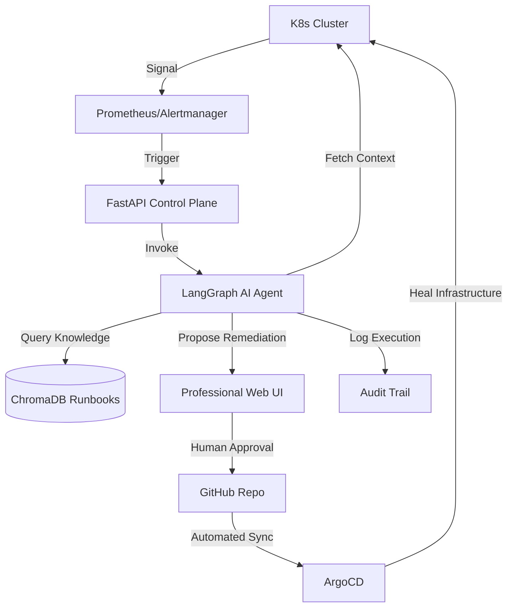

# 🌐 OmniRoute: Enterprise AIOps Self-Healing Control Plane

[](https://kubernetes.io/)
[](https://langchain-ai.github.io/langgraph/)
[](https://argoproj.github.io/cd/)
[](https://fastapi.tiangolo.com/)

## 📖 Executive Summary
**OmniRoute** is a production-grade AIOps platform designed to eliminate the "3 AM wake-up call" for SREs. It transforms traditional reactive monitoring into an **autonomous self-healing loop**. 

Unlike simple scripts, OmniRoute implements a **Control Plane** architecture that combines **LLM-driven reasoning (LangGraph)**, **Knowledge Retrieval (RAG)**, and **Immutable Infrastructure (GitOps)** to diagnose and remediate Kubernetes incidents with human-in-the-loop safety guardrails.

---

## 🚀 Enterprise Feature Set (Real-World Solutions)

This project is built to solve specific, high-impact production issues that a Senior DevOps Engineer faces daily:

### 1️⃣ Autonomous Incident Triage (Solving Alert Fatigue)
- **The Problem:** On-call engineers receive hundreds of alerts, many of which are noise or recurring.
- **The Solution:** OmniRoute automatically intercepts alerts and performs the "First Response." It aggregates logs, checks metrics, and classifies the incident *before* a human is notified.
- **Impact:** Reduces noise and ensures that when a human is paged, they have a full diagnostic report ready.

### 2️⃣ Runbook-Grounded Remediation (Solving AI Hallucinations)
- **The Problem:** LLMs can suggest dangerous or incorrect commands if left unchecked.
- **The Solution:** Using **ChromaDB RAG**, the agent is strictly grounded in a library of human-verified runbooks. If a fix isn't in the runbook, the agent flags it as "Risky."
- **Impact:** Zero-trust AI execution. Only verified, safe procedures are suggested.

### 3️⃣ Immutable GitOps Workflow (Solving Configuration Drift)
- **The Problem:** Manual `kubectl edit` changes lead to "drift," where the cluster state differs from the Git repo.
- **The Solution:** The agent **never** modifies the cluster directly. It creates a Git commit $\rightarrow$ triggers **ArgoCD** $\rightarrow$ ArgoCD syncs the cluster.
- **Impact:** 100% traceability and instant rollback capability for every AI action.

### 4️⃣ Human-in-the-Loop (HITL) Control Plane (Solving Production Risk)
- **The Problem:** Giving an AI "Write" access to production is a massive security risk.
- **The Solution:** A dedicated **FastAPI-powered Dashboard** where an engineer must explicitly approve an AI's suggested fix.
- **Impact:** Combines AI speed with human judgment, ensuring no unauthorized changes reach production.

---

## 📐 System Architecture

### 🔹 The AIOps Loop


### 🔹 Deployment Topology
- **Control Plane:** FastAPI + Uvicorn (Running in K8s)
- **Agent Engine:** LangGraph + OpenAI GPT-4o
- **Knowledge Layer:** ChromaDB Vector Store
- **Delivery Layer:** ArgoCD $\rightarrow$ Kubernetes

---

## 🎙️ Interviewer's Guide: How to Explain This Project

*When the interviewer asks, "Tell me about this project," use this narrative:*

**1. The "Why" (The Problem):**
> "In most production environments, SREs suffer from alert fatigue. They get paged for recurring issues like OOMKills or CrashLoops that have known fixes. I built OmniRoute to automate the 'Triage' and 'Remediation' phases of the incident lifecycle."

**2. The "How" (The Technical Approach):**
> "I implemented a stateful agent using **LangGraph**. When an alert hits the system, the agent doesn't just guess a fix; it performs a multi-step diagnostic: it pulls real-time logs from the cluster, uses **RAG via ChromaDB** to find a matching verified runbook, and then classifies the fix as 'Safe' or 'Risky'."

**3. The "Production Mindset" (The Safety):**
> "To ensure this is production-ready, I implemented two critical guardrails. First, **Human-in-the-Loop approval** via a custom dashboard, so no change happens without a human eye. Second, a **GitOps workflow using ArgoCD**, ensuring that every single remediation is version-controlled and can be rolled back instantly."

---

## 🚀 Professional Deployment Blueprint

### 1️⃣ Infrastructure Foundation
```bash
# Provision Cluster
kind create cluster --name omniroute-prod

# Apply Security Guardrails (Least Privilege RBAC)
kubectl apply -f infra/rbac/agent-rbac.yaml

# Seed Production Failure Scenarios
kubectl apply -f infra/chaos/failure-seeds.yaml
```

### 2️⃣ Backend Engine Setup
```bash
# Setup Environment
python3 -m venv venv && source venv/bin/activate
pip install -r requirements.txt

# Initialize Control Plane
export OPENAI_API_KEY='your-key'
uvicorn main:app --host 0.0.0.0 --port 8000
```

### 3️⃣ Dashboard Launch
```bash
# Launch the Cyber-Ops UI
open frontend/index.html
```

### 4️⃣ End-to-End Validation
1. **Trigger:** Send alert to API $\rightarrow$ `POST /trigger-diagnosis`
2. **Triage:** AI Agent fetches logs $\rightarrow$ RAG matches runbook $\rightarrow$ Proposes Fix.
3. **Approval:** Open Dashboard $\rightarrow$ Review Fix $\rightarrow$ Click **[Approve]**.
4. **Healing:** ArgoCD syncs Git commit $\rightarrow$ K8s Pod heals.
5. **Audit:** Review `agent_audit.log` for full traceability.
