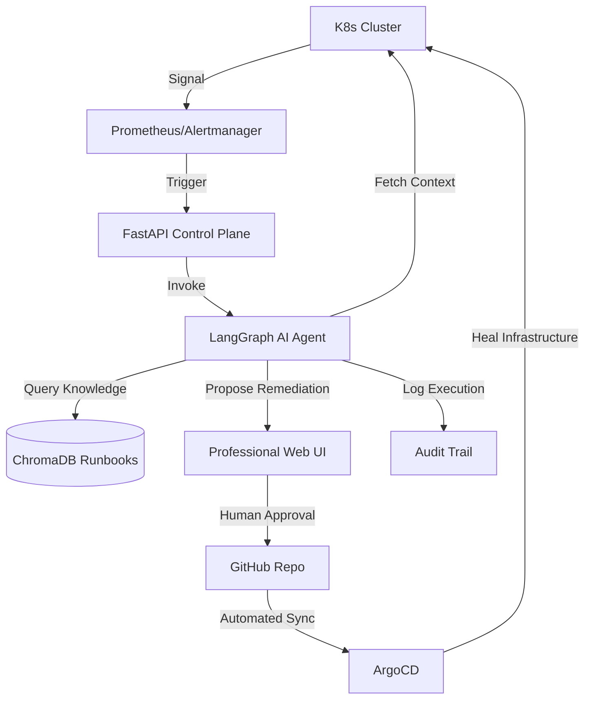

# 🌐 OmniRoute: Enterprise AIOps Self-Healing Control Plane

[](https://kubernetes.io/)
[](https://langchain-ai.github.io/langgraph/)
[](https://argoproj.github.io/cd/)
[](https://fastapi.tiangolo.com/)

## 📖 Executive Summary
**OmniRoute** is a production-grade AIOps platform designed to eliminate the "3 AM wake-up call" for SREs. It transforms traditional reactive monitoring into an **autonomous self-healing loop**. 

Unlike simple scripts, OmniRoute implements a **Control Plane** architecture that combines **LLM-driven reasoning (LangGraph)**, **Knowledge Retrieval (RAG)**, and **Immutable Infrastructure (GitOps)** to diagnose and remediate Kubernetes incidents with human-in-the-loop safety guardrails.

---

## 🚀 Enterprise Feature Set (Real-World Solutions)

| Real-World Issue | OmniRoute Solution | Technical Implementation |
| :--- | :--- | :--- |
| **Alert Fatigue** | **Autonomous Diagnosis** | AI Agent automatically aggregates logs and metrics *before* paging a human. |
| **Human Error in Fixes** | **Runbook Grounding (RAG)** | Fixes are retrieved from verified human-written runbooks, not LLM hallucinations. |
| **Production Risk** | **Human-in-the-Loop (HITL)** | A professional UI requires an engineer to "Approve" any fix before it is applied. |
| **Configuration Drift** | **GitOps Remediation** | No `kubectl edit`. All fixes are committed to Git and synced via ArgoCD. |
| **Lack of Accountability** | **Immutable Audit Trail** | Every decision, from diagnosis to approval, is logged in a tamper-proof audit trail. |

---

## 📐 System Architecture

### 🔹 The AIOps Loop


### 🔹 Deployment Topology
- **Control Plane:** FastAPI + Uvicorn (Running in K8s)
- **Agent Engine:** LangGraph + OpenAI GPT-4o
- **Knowledge Layer:** ChromaDB Vector Store
- **Delivery Layer:** ArgoCD $\rightarrow$ Kubernetes

---

## 🎙️ Interviewer's Guide: How to Explain This Project

*When the interviewer asks, "Tell me about this project," use this narrative:*

**1. The "Why" (The Problem):**
> "In most production environments, SREs suffer from alert fatigue. They get paged for recurring issues like OOMKills or CrashLoops that have known fixes. I built OmniRoute to automate the 'Triage' and 'Remediation' phases of the incident lifecycle."

**2. The "How" (The Technical Approach):**
> "I implemented a stateful agent using **LangGraph**. When an alert hits the system, the agent doesn't just guess a fix; it performs a multi-step diagnostic: it pulls real-time logs from the cluster, uses **RAG via ChromaDB** to find a matching verified runbook, and then classifies the fix as 'Safe' or 'Risky'."

**3. The "Production Mindset" (The Safety):**
> "To ensure this is production-ready, I implemented two critical guardrails. First, **Human-in-the-Loop approval** via a custom dashboard, so no change happens without a human eye. Second, a **GitOps workflow using ArgoCD**, ensuring that every single remediation is version-controlled and can be rolled back instantly."

---

## 🛠️ COMPLETE STEP-BY-STEP SETUP GUIDE

Follow these steps exactly to deploy the project from scratch.

### 1️⃣ Phase 1: Prerequisites & Tools
Ensure you have the following installed:
- **Docker Desktop** (Required for Kind/Minikube)
- **Kind** (`brew install kind`) - used to create a local Kubernetes cluster.
- **kubectl** (`brew install kubernetes-cli`) - the CLI for controlling K8s.
- **Python 3.10+**
- **OpenAI API Key** - Needed for the AI's reasoning capabilities.

### 2️⃣ Phase 2: Kubernetes Infrastructure Setup
We need to provision the cluster and seed it with "failure scenarios" so we have something to fix.

```bash
# A. Create the cluster
kind create cluster --name omniroute-cluster

# B. Apply Security RBAC
# This gives the AI Agent the correct, limited permissions to read logs and patch deployments
kubectl apply -f infra/rbac/agent-rbac.yaml

# C. Seed the Chaos Failures
# This creates pods that are intentionally crashing or running out of memory
kubectl apply -f infra/chaos/failure-seeds.yaml

# D. Verify the "Broken" state
kubectl get pods
# You should see pods in 'CrashLoopBackOff' or 'OOMKilled' status.
```

### 3️⃣ Phase 3: Backend Control Plane Installation
The backend handles the API and the LangGraph AI Agent logic.

```bash
# A. Clone and enter the repository
git clone https://github.com/Ayush-Singh986/GitOps-Driven-Self-Healing-Infrastructure.git
cd GitOps-Driven-Self-Healing-Infrastructure

# B. Set up a virtual environment
python3 -m venv venv
source venv/bin/activate

# C. Install all professional dependencies
pip install -r requirements.txt

# D. Set your API Key
export OPENAI_API_KEY='your-openai-api-key-here'

# E. Start the Control Plane Server
uvicorn main:app --host 0.0.0.0 --port 8000
```
*The server is now live at `http://localhost:8000`.*

### 4️⃣ Phase 4: Launching the Dark-Ops UI
The UI allows you to interact with the AI and approve its suggestions.

```bash
# Open the professional dashboard in your browser
open frontend/index.html
```

### 5️⃣ Phase 5: End-to-End Execution (The Demo Loop)
Test the system by triggering a diagnosis and approving the fix.

**Step A: Trigger the AI to diagnose a failure**
```bash
curl -X POST "http://localhost:8000/trigger-diagnosis" \
     -H "Content-Type: application/json" \
     -d '{"alert_id": "alert-oom-001"}'
```

**Step B: Review in the UI**
1. Go to your browser (`frontend/index.html`).
2. Look at the **Incident Feed**. You will see the AI has analyzed the pod and suggested a fix (e.g., "Increase memory to 256Mi").
3. Click the **[Approve Fix]** button.

**Step C: Trigger Approval via API (Alternative to UI)**
If you prefer the CLI, use the request ID from the trigger step:
```bash
curl -X POST "http://localhost:8000/approve-remediation" \
     -H "Content-Type: application/json" \
     -d '{"request_id": "YOUR_REQUEST_ID", "action": "approve"}'
```

**Step D: Verify the Healing**
Check your cluster to see the pod returning to a healthy state:
```bash
kubectl get pods
```

### 6️⃣ Phase 6: Audit & Verification
Check the audit trail to see the full decision-making process of the AI:
```bash
cat agent_audit.log
```
This log proves the agent followed the runbook and waited for human approval.
