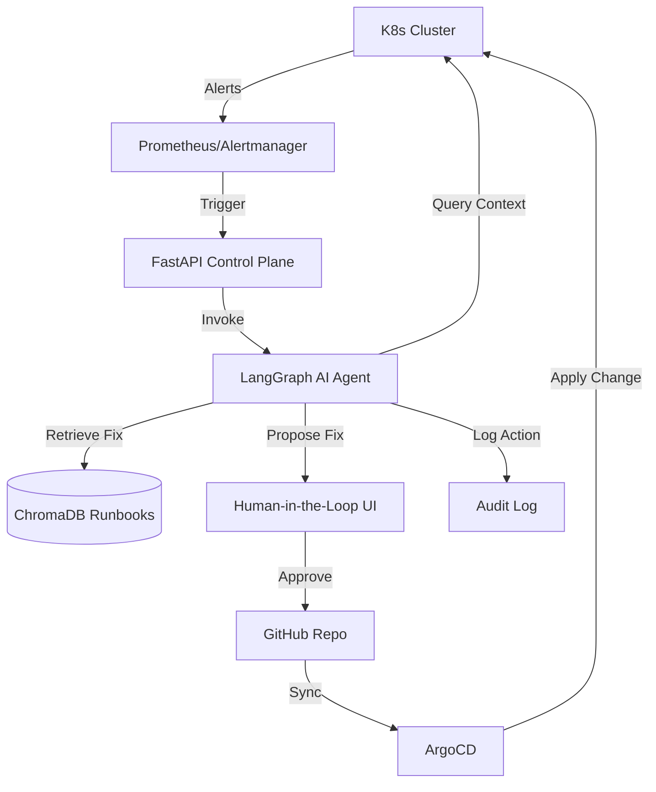
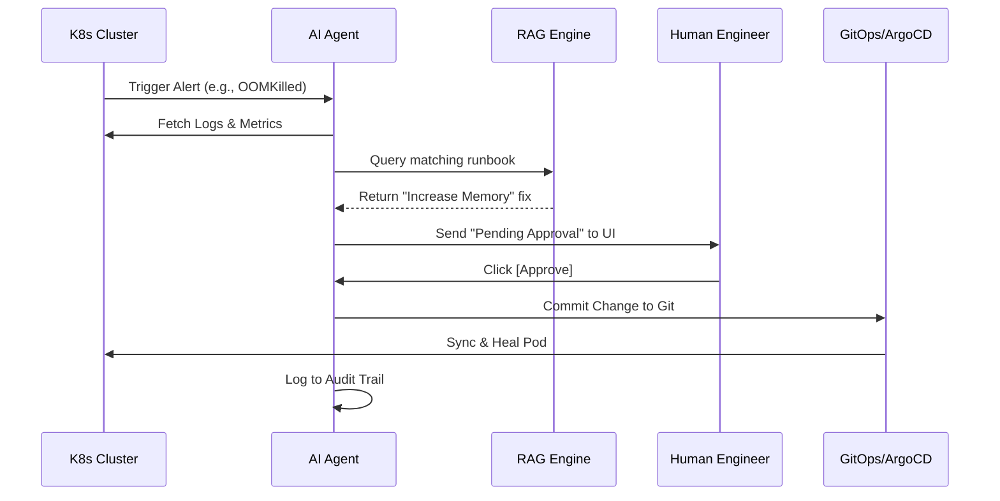

# 🚀 GitOps-Driven Self-Healing Infrastructure

An autonomous AI agent for Kubernetes incident detection & remediation (AIOps).

## 🌟 Project Overview (The "Beginner-Friendly" Explanation)

### What is this project?
Imagine a Kubernetes cluster (the system that runs your apps) as a large city. Sometimes, things break: a building collapses (a Pod crashes), or a road gets blocked (a Disk fills up). Normally, a human engineer (an "On-Call Engineer") gets a phone call at 3 AM, wakes up, logs in, and fixes it.

**This project replaces that 3 AM phone call with an AI Agent.**

### How does it work?
1.  **The Alarm (Prometheus/Alertmanager):** The system detects a problem (e.g., "App X is crashing") and sends an alarm.
2.  **The Brain (LangGraph Agent):** The AI agent hears the alarm. It doesn't just guess; it acts like a detective. It looks at the logs, checks the memory usage, and asks, "Why is this happening?"
3.  **The Library (RAG Runbooks):** The agent looks at a "Runbook"—a manual written by humans that says: *"If the app crashes because of memory, increase the memory limit."*
4.  **The Safety Guard (Decision):** The agent decides if the fix is **Safe** (e.g., "I'll just give it more memory") or **Risky** (e.g., "I need to delete a database"). 
    - If it's **Safe**, it fixes it automatically.
    - If it's **Risky**, it writes a detailed report and asks a human for help.
5.  **The Robot Hand (ArgoCD/GitOps):** Instead of just "hacking" the system, the agent follows a strict process: it makes a change in the code (Git), and **ArgoCD** safely applies that change to the cluster.

---

## 🛠️ Step-by-Step Setup Guide

### 1. Prerequisites
You will need:
- **Docker** installed.
- **Kind** or **Minikube** (to run Kubernetes locally).
- **kubectl** (the Kubernetes command-line tool).
- **Python 3.10+** installed.
- **OpenAI API Key** (for the Agent's brain).

### 2. Infrastructure Setup
First, create your cluster and apply the security and chaos manifests:

```bash
# 1. Create a cluster
kind create cluster --name self-healing-cluster

# 2. Apply RBAC (Security Guardrails)
kubectl apply -f infra/rbac/agent-rbac.yaml

# 3. Seed the failures (Create the "problems" for the AI to fix)
kubectl apply -f infra/chaos/failure-seeds.yaml
```

### 3. Agent Installation
Set up the AI Agent in a Python environment:

```bash
# 1. Clone the repo
git clone https://github.com/Ayush-Singh986/GitOps-Driven-Self-Healing-Infrastructure.git
cd GitOps-Driven-Self-Healing-Infrastructure

# 2. Install dependencies
pip install -r requirements.txt

# 3. Set your OpenAI Key
export OPENAI_API_KEY='your-api-key-here'
```

### 4. Running the AI Agent
Start the agent to detect and fix the seeded failures:

```bash
# Run the agent core
python3 -c "from agent.core.agent import RemediationAgent; agent = RemediationAgent(); print(agent.run('alert-oom-001'))"
```

### 5. Verifying the Fix
Check the logs to see the agent's decision and check your pods to see them returning to health:

```bash
# Check the audit log
cat agent_audit.log

# Check pod status
kubectl get pods
```

---

## 📐 Technical Architecture

### 🔹 System Overview
The system follows a closed-loop control pattern: **Observe $\rightarrow$ Orient $\rightarrow$ Decide $\rightarrow$ Act**.



### 🔹 Sequence Flow (How a fix happens)


---

## 🛠️ Step-by-Step Setup Guide
